# SDV Cluster HMI with Signed A/B OTA Updates

A **software-defined-vehicle** reference demo built end to end in **C++17 and Qt 6 / QML**. It runs as separate containers:

- a mock zonal ECU that publishes vehicle signals over **SOME/IP**
- a **Qt Quick digital cluster** whose UI is an OTA-updatable bundle
- an on-vehicle **OTA agent** with signed manifests, A/B slots, a health gate and automatic rollback
- a backend that builds, hashes, signs and serves releases
- a **mixed-criticality cockpit**: a hypervisor-style partition manager runs the cluster (safety partition) next to an infotainment guest that projects navigation into the cluster through inter-VM shared memory, with fault injection to prove isolation ([details](#mixed-criticality-cockpit-hypervisor))

The cluster updates **while it is running, without a restart**. A broken release is caught by the health check and rolled back, and the screen never goes blank. Forged or tampered releases are rejected before anything on the vehicle changes.

| Factory UI 1.0.0 | Update offered over the air |
|---|---|
| 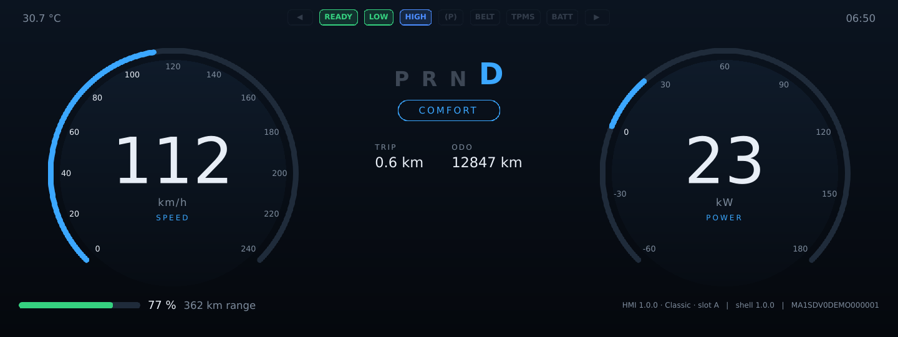 | 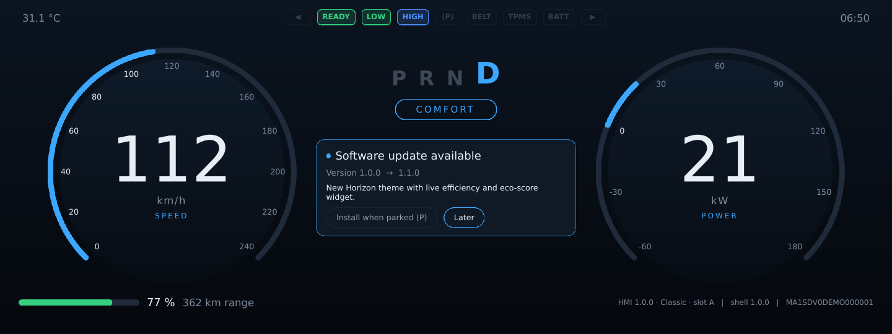 |
| **Hot-swapped to 1.1.0 (slot B)** | **New feature delivered by OTA** |
| 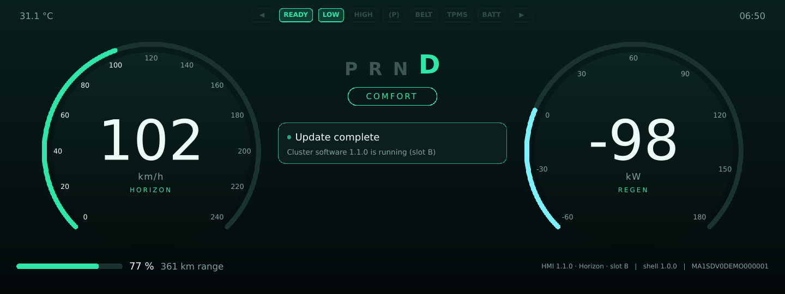 | 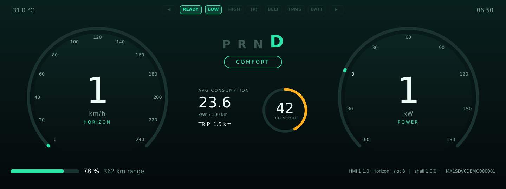 |
| **Broken 1.2.0 → automatic rollback** | **Forged release rejected** |
| 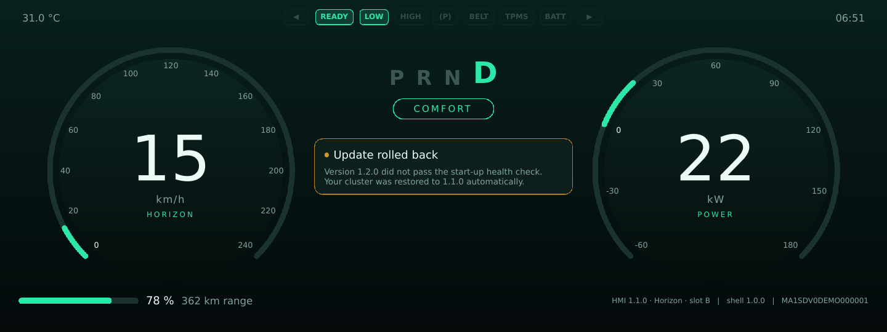 | 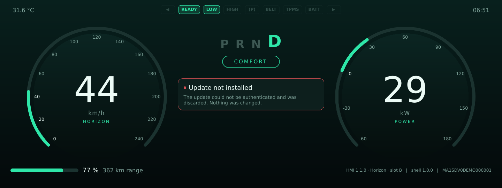 |

---

## Architecture

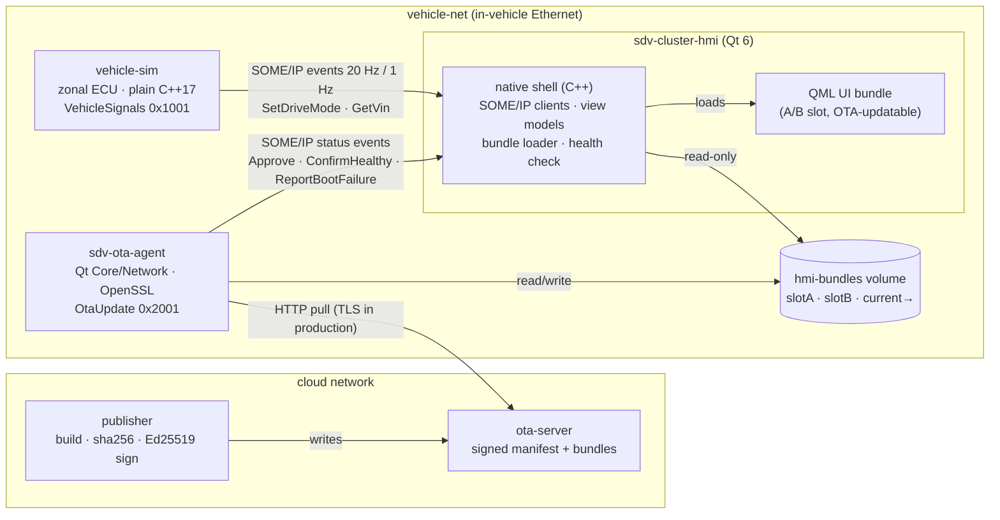

The **native shell** (C++, SOME/IP, view models) ships with the base image. The **QML UI** is a versioned bundle that is updated over the air. This is the split many OEMs use to ship HMI features quickly without re-flashing the whole ECU.

### Components

| Directory | What | Tech |
|---|---|---|
| `someip/` | Small, dependency-free, **wire-compatible** SOME/IP codec. It implements the 16-byte header, big-endian serialization and SOME/IP-SD SubscribeEventgroup/Ack. Packets decode in Wireshark. | C++17 |
| `vehicle-sim/` | Mock zonal ECU with a longitudinal EV model (mass, aero, rolling, regen, battery) on a scripted city/highway cycle. It handles subscription TTLs and serves request/response methods. | C++17, POSIX sockets (no Qt, like a real ECU) |
| `hmi/src/` | Cluster shell: `SomeIpClient` (QUdpSocket, SD renewal, liveness), `VehicleState` and `OtaClient` (Q_PROPERTY view models), and `HmiShell` (A/B bundle loader, hot swap, health reporting, screenshots) | Qt 6 Core/Network/Qml/Quick |
| `hmi/bundle-src/` | QML UI bundles: `common/` plus per-version overlays. 1.0.0 is "Classic", 1.1.0 is "Horizon" with the efficiency widget, and 1.2.0 is deliberately incompatible. | QML, Qt Quick Shapes |
| `ota-agent/` | Update state machine. It covers manifest signature verification, size and SHA-256 checks, extraction into the inactive slot with path-traversal checks, atomic slot switching, a write-ahead persisted transaction, the health gate, rollback and blacklisting. | Qt 6 Core/Network, OpenSSL 3 |
| `ota-server/` | Release server with no-store caching and bandwidth throttling to emulate a cellular link | Python stdlib |
| `tools/` | Bundle builder (reproducible tar), key generation, signing and publishing, factory provisioning, local demo, screenshot capture | bash, openssl |
| `cockpit/` | **Hypervisor cockpit**: `ivshm` inter-VM shared memory library, `sdv-hypervisor` partition manager, `sdv-ivi-guest` infotainment partition | C++17, POSIX shm, Qt 6 Gui |
| `tests/` | Qt Test unit tests (codec, crypto, inter-VM channel including concurrency and MMU-permission tests), the **end-to-end OTA test** and the **cockpit fault-injection test** | Qt Test, bash |
| `docker/`, `docker-compose.yml` | Multi-target image build with one minimal container per component, and two isolated networks | Docker / OCI |

---

## SOME/IP interface

| Service | ID | Element | ID | Payload |
|---|---|---|---|---|
| VehicleSignals | `0x1001` | Speed (event, 20 Hz) | `0x8001` | f32 km/h |
| | | Power (event, 20 Hz) | `0x8002` | f32 kW (negative = regen) |
| | | Gear / Telltales / DriveMode (on change + 1 Hz) | `0x8003` / `0x8005` / `0x8006` | u8 / u32 bitmask / u8 |
| | | Battery / Odometer / Outside temp (1 Hz) | `0x8004` / `0x8007` / `0x8008` | f32 SoC, f32 range / f32 odo, f32 trip / f32 °C |
| | | SetDriveMode (method) | `0x0001` | u8 → u8 |
| | | GetVin (method) | `0x0002` | – → string |
| OtaUpdate | `0x2001` | Status (event, on change + 1 Hz) | `0x8001` | state, installed, available, progress, message, notes, slot |
| | | ApproveInstall / Defer / CheckNow | `0x0001` / `0x0002` / `0x0004` | – → u8 accepted |
| | | ConfirmHealthy | `0x0003` | string version |
| | | ReportBootFailure | `0x0005` | string version, string reason |

Consumers subscribe with **SOME/IP-SD SubscribeEventgroup** (TTL 3 s, renewed at TTL/2). Providers ACK or NACK and drop expired subscribers. If events stop, the HMI shows a *"Vehicle signals unavailable"* state instead of frozen values.

---

## OTA flow and safety properties

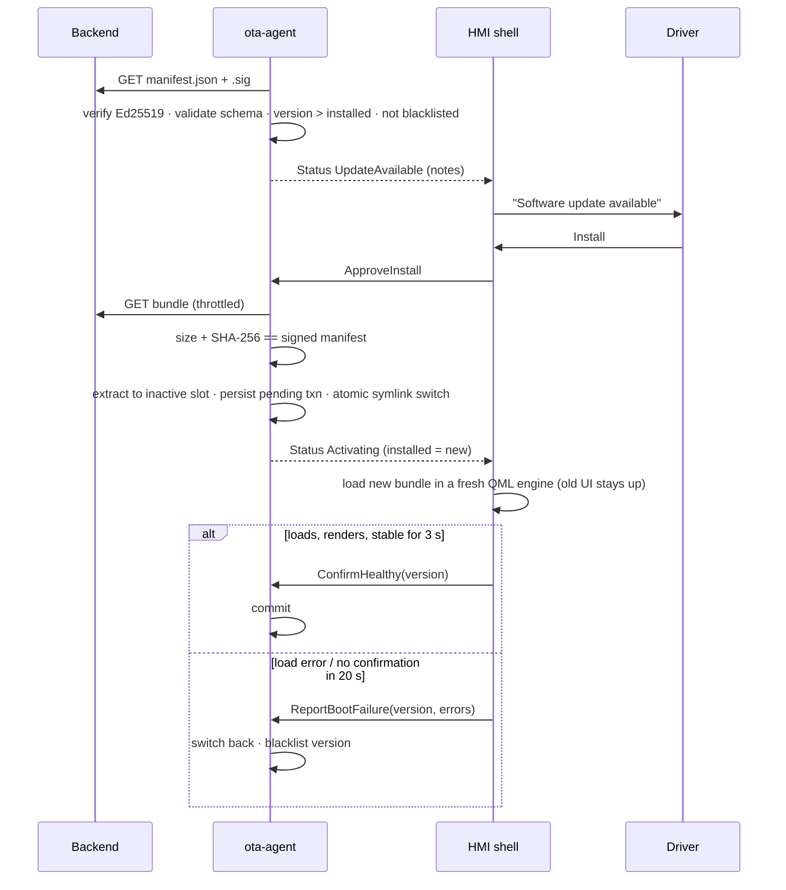

- **Authenticity before parsing.** Nothing in a manifest is trusted until its Ed25519 signature verifies against the trust anchor baked into the vehicle. The private key exists only on the backend, and the vehicle receives only the public key.
- **Integrity.** The bundle's size and SHA-256 must match the *signed* manifest. Downloads cannot exceed the announced size.
- **Defensive install.** Archive entries with absolute paths or `..` are refused. The `bundle.json` version must match the manifest. The entry point must exist.
- **Atomic activation.** `current` is switched with `symlink()` + `rename(2)`, and state files are written with temp-file-plus-rename (`QSaveFile`).
- **Write-ahead transaction.** The pending slot is persisted *before* switching. If the agent restarts mid-activation, it resumes the health window, with a bounded number of attempts before rollback.
- **No blank cluster.** The shell loads the new bundle in a separate `QQmlApplicationEngine` and destroys the old UI only after the new one exists.
- **Health gate.** The update is confirmed only after the first presented frame plus a stability window. A missing confirmation leads to rollback by timeout.
- **Least privilege.** The HMI mounts the bundle volume read-only. Only the agent is connected to the cloud network, in the telematics-gateway role.
- **Driver consent.** Install is enabled only while parked (gear P). Demo and CI can override this with `HMI_AUTO_APPROVE=any`.

---

## Quick start

### Native (Linux, Qt ≥ 6.4)

```bash
sudo apt install build-essential cmake libssl-dev qt6-base-dev qt6-declarative-dev \
     qml6-module-qtquick qml6-module-qtquick-shapes qml6-module-qtquick-window fonts-dejavu-core

make test            # build + unit tests
make e2e             # full OTA scenario test, headless (≈1 min)
make demo-local      # opens the cluster window
# in a second terminal:
tools/publish_release.sh 1.1.0 .demo/server "New Horizon theme and live efficiency widget"
tools/publish_release.sh 1.2.0 .demo/server "Navigation preview"       # watch it roll back
```

### Containers

```bash
make up              # generates keys, builds images, starts the stack
                     # view the cluster: any VNC viewer -> localhost:5900
make publish-1.1     # publish signed 1.1.0 -> tap "Install now" when the car is in P
make publish-1.2     # broken release -> automatic rollback
make logs            # follow ota-agent + hmi
make down
```

### End-to-end test output

```
▶ 1. factory boot
  PASS HMI subscribed to VehicleSignals over SOME/IP-SD
  PASS HMI subscribed to OtaUpdate
  PASS factory UI 1.0.0 rendered and stable
▶ 2. signed update 1.1.0
  PASS agent verified signature and offered 1.1.0
  PASS driver consent -> download started
  PASS sha256 verified, installed to slot B, activated
  PASS HMI hot-swapped to 1.1.0 without restart
  PASS HMI health confirmed -> update committed
  PASS persistent state: committed slot B
▶ 3. broken update 1.2.0 -> automatic rollback
  PASS HMI detected 1.2.0 cannot load
  PASS previous UI kept on screen (no blank cluster)
  PASS agent rolled back to slot B / 1.1.0
  PASS current -> slotB
  PASS 1.2.0 blacklisted (not re-offered)
▶ 4. manifest signed by rogue key
  PASS forged manifest rejected
  PASS nothing downloaded
▶ 5. bundle tampered in transit
  PASS tampered bundle rejected by sha256
  PASS vehicle still on 1.1.0 / slot B
```

---

## Mixed-criticality cockpit (hypervisor)

A cockpit domain controller usually runs a **type-1 hypervisor** with two kinds of guest. One is a safety-relevant cluster VM (QNX or Linux, ASIL-B). The other is a QM infotainment VM, typically Android Automotive. The hard engineering problem is **freedom from interference**: the IVI may hang, leak, spin or send garbage, and the cluster must keep rendering. This part of the repo builds that architecture and tests it with fault injection.

| Navigation projected from the IVI partition | IVI frames corrupt → cluster-native fallback | IVI hung → guidance withdrawn |
|---|---|---|
| 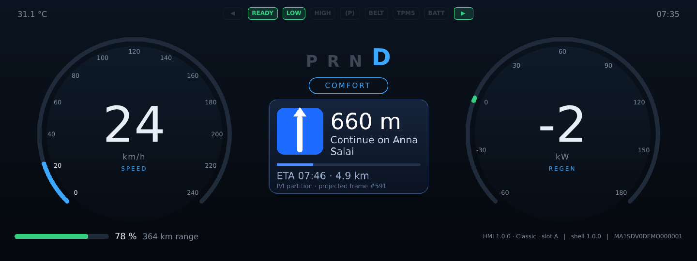 | 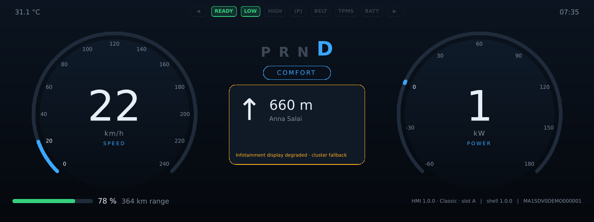 | 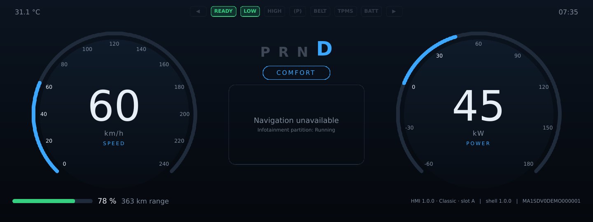 |

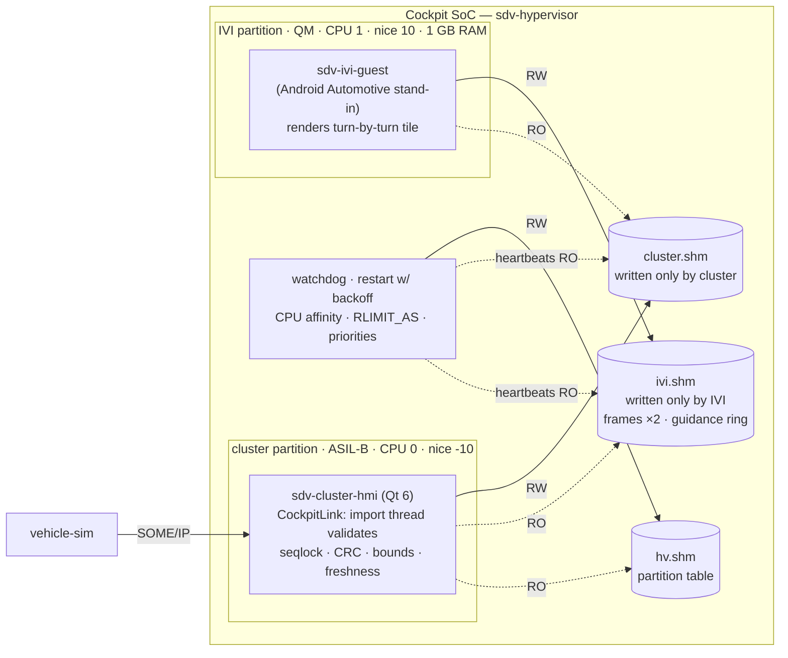

### What is emulated and what it stands for

| This repo | On a real cockpit SoC |
|---|---|
| `sdv-hypervisor` forks partitions and applies CPU affinity, nice and `RLIMIT_AS` | VM config of QNX Hypervisor / Xen / Gunyah / COQOS: vCPU pinning, scheduler weights, guest RAM size |
| One shared-memory file per writer, mapped `PROT_READ` by everyone else | ivshmem / virtio shmem regions with **stage-2 MMU permissions**. A guest physically cannot write a peer's memory, and a unit test proves the write faults. |
| Double-buffered frame surface with per-slot seqlock and CRC | Shared GPU buffer or virtio-gpu scanout projected into the cluster compositor |
| SPSC message rings: head in the producer's region, tail in the consumer's | virtio queues / vsock between guests |
| Heartbeat watchdog with exponential-backoff restart | Hypervisor VM health monitor / guest watchdog device |
| `sdv-ivi-guest` (Qt/QPainter) | Android Automotive app projecting through a VHAL/HAL into a shared buffer |

### How the cluster protects itself

- **Untrusted by default.** Everything read from the IVI is copied first and then validated on the private copy: ring indices, message lengths, frame dimensions, stride and CRC-32. There are no in-place reads, so there are no TOCTOU gaps.
- **Validation off the render thread.** A low-priority import thread does the copy and checks. The GUI thread only swaps an implicitly shared `QImage`.
- **Own clock, own decision.** Freshness is judged by the cluster. If frames are older than 500 ms or invalid, the tile drops to a *cluster-rendered* fallback built from structured guidance data. If guidance is older than 1 s, the tile shows *"Navigation unavailable"* rather than stale directions.
- **Bounded work.** At most 64 messages are processed per 10 ms poll, and an overloaded ring drops messages at the *producer*, which counts them.
- **Restart-tolerant.** Regions carry a generation counter, so either side can restart and the peer resynchronises without stale data.

### Fault-injection results (`tests/e2e_cockpit.sh`, runs in CI)

| Fault injected into the IVI | Cluster reaction | Hypervisor reaction | Cluster restarted? |
|---|---|---|---|
| Corrupt frames (bad CRC) | Rejects from the first bad frame and shows the native fallback within 0.5 s. Restores the projection when frames are valid again. | – | No |
| Hang (`SIGSTOP`) | Degraded at 0.5 s, unavailable at 1 s | Watchdog reset at 1 s, IVI back about 0.3 s later | No |
| Ring flood | Stays *Healthy*, and the overload is logged as drops at the source | – | No |
| Memory leak | – | IVI aborts at its 1 GB ceiling and restarts with backoff | No |
| CPU storm (busy threads) | No heartbeat miss, frame rate kept (see measurements) | – | No |
| **Cluster** killed | Restarts and re-attaches (generation 2). The projection resumes. | Restart in 200 ms, first frame about 0.1–0.3 s later | IVI not restarted |

### Measured: partitioning on vs. off under an IVI CPU storm

`tools/measure_isolation.sh` runs the same storm twice: with partitioning, and with `--no-isolation`, where both partitions share all CPUs at equal priority. It reports the cluster GUI thread's scheduling latency (lateness of a 10 ms timer) and the frame interval.

| Partitioning | IVI load | UI-thread latency p99 | UI-thread latency max | Frame interval p99 |
|---|---|---|---|---|
| **ON** | idle | 4.7 ms | 7.8 ms | 20.4 ms |
| **ON** | CPU storm | **5.4 ms** | 10.2 ms | 19.4 ms |
| OFF | idle | 4.0 ms | 10.7 ms | 15.2 ms |
| OFF | CPU storm | **18.0 ms** | 24.6 ms | 27.0 ms |

With partitioning, the storm moves the cluster's p99 latency by under 1 ms. Without it, p99 latency grows about 4.5× and the frame interval p99 nearly doubles. These figures come from a 2-vCPU cloud VM with Qt's software renderer. Absolute values will differ on target hardware, but the comparison is the point.

### Run it

```bash
make e2e-cockpit           # 21 automated checks, headless (~1 min)
make measure-isolation     # the table above, on your machine
make demo-cockpit          # cluster window + IVI guest; then in another terminal:
build/bin/sdv-hypervisor --status
build/bin/sdv-hypervisor --inject ivi:corrupt      # hang | cpu-storm | mem-bomb | flood | kill
make up-cockpit            # containerised: VNC localhost:5901
```

```
PARTITION  ASIL     STATE            PID  RESTARTS  RECOVERY_MS
cluster    ASIL-B   Running         2868         1          101
ivi        QM       Running         2823         2          101
```

**Honest scope.** These are Linux processes with kernel-enforced CPU, priority, memory and page-permission isolation, not virtual machines. The architecture, interfaces, validation logic and failure handling carry over to a real hypervisor. Real hardware would add separate kernels and GPU or display partitioning, and a certified hypervisor, which this repo does not have.

---

## Design decisions

| Decision | Why | Production alternative |
|---|---|---|
| Own SOME/IP codec instead of vsomeip | Zero middleware dependency, it fits in one review, and it is wire-compatible | vsomeip / CommonAPI with Franca/ARXML-generated proxies |
| OTA of the **UI bundle**, not the whole image | Fast HMI feature delivery and a demonstrable hot swap | Combine with full-image A/B (RAUC / SWUpdate / Mender, dm-verity) for the shell and OS |
| Health = "loads + first frame + stable N s" | Catches the most common HMI regression class: incompatible QML or API | Add watchdog heartbeats, frame-time KPIs and crash counters |
| Single signed manifest | Clear, testable trust chain | Uptane / TUF metadata (role separation, key rotation, freeze/rollback-attack protection) |
| UDP-only, unauthenticated SOME/IP | Matches typical in-vehicle deployments | SecOC / TLS-SOME/IP, IDS on the vehicle network |
| Processes + shared memory for the hypervisor cockpit | Runs anywhere, deterministic fault injection, testable in CI | Real VMs on QNX Hypervisor / Xen / Gunyah, virtio-gpu or display-partitioned compositor |

**Safety note.** In a production cluster, ISO 26262-relevant telltales must not depend on an updatable QML layer. They belong in a separately rendered safety path, such as Qt Safe Renderer or a safety-island MCU. Here they live in QML for demo purposes only.

## Roadmap

- vsomeip backend behind the same `SomeIpClient` interface
- Uptane-style director/image repositories with version-rollback protection
- Activation gated on vehicle state (parked + HV off), reported by the vehicle service
- Delta updates (bsdiff/zstd) and resumable downloads
- Qt Quick boot-time KPIs (first frame, telltale latency) published as metrics
- Cockpit: run the guests as real VMs (QEMU/KVM + ivshmem) and swap the IVI stand-in for an Android Automotive image

## License

MIT
